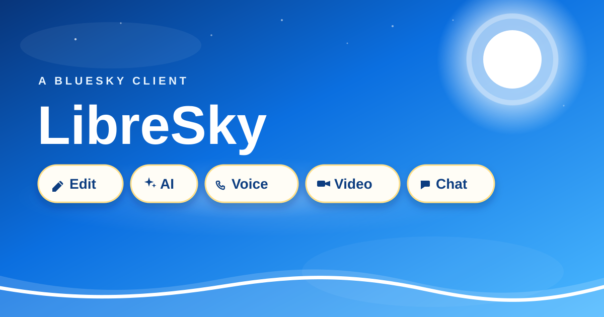
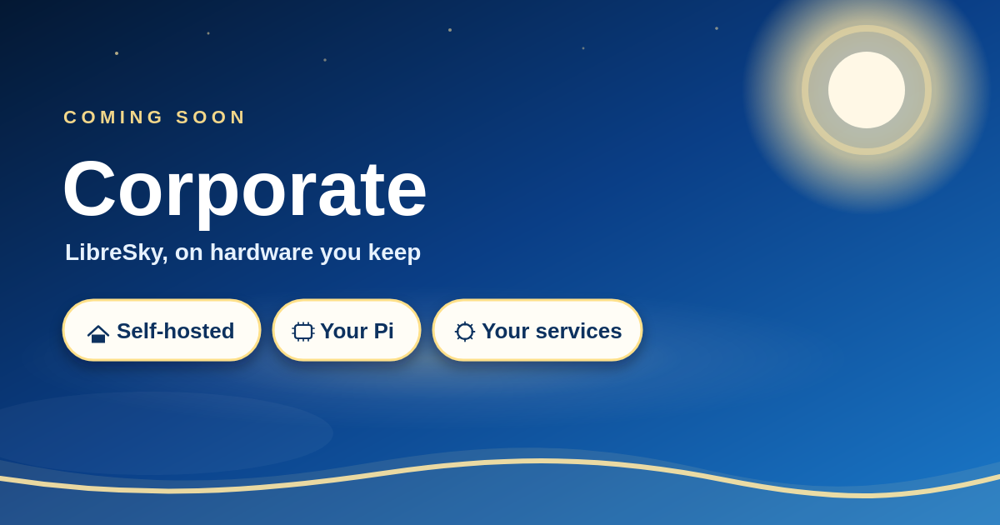

# LibreSky

The sky, in a browser tab.

LibreSky is a Bluesky client you open and stay in. Home is waiting. Discover is one click over. Search starts on what people are talking about right now. Chat, notifications, bookmarks, and your profile sit in the sidebar, and a voice or video call can leave straight from a conversation.

**[Open LibreSky](https://thewhitewitchtm.github.io/LibreSky/)**

## Walk in

The first screen is sign-in. Make an account there if you need one. Bluesky’s own page takes the password. This browser keeps you signed in until you sign out.

## Everything in reach

- **Home and Discover** stay on the row. Lists and saved feeds you add sit there too.
- **Search** opens on trending topics, then finds people, posts, and feeds.
- **Notifications, chat, bookmarks, and your profile** live in the sidebar.
- **Feeds, lists, starter packs, settings, About, Privacy, and Terms** live under More.

Posts come from your Bluesky account. The whole client is this site.

## Say it out loud

Voice and Video sit on an open chat and on someone else’s profile. A call reaches another LibreSky window directly. Both people need the app open. The sound and the picture travel between the two browsers.

## Ask in the same breath

Type `@ai` or `@si`. Settings can hold a Grok, Gemini, OpenAI, DeepSeek, or other account on your Bluesky account, and those tags ask that account. The key follows that login. The [AI page](https://thewhitewitchtm.github.io/LibreSky/#/ai) explains how.

## A desk of your own

Linux, Windows, and Mac builds are on the [download page](https://thewhitewitchtm.github.io/LibreSky/#/downloads). Unzip and run. Sign-in still uses your Bluesky account. On a Mac, right-click LibreSky.app and choose Open. The Mac app is not signed.

## Small enough to keep

The pages and scripts are about 1.6 MB. A small Raspberry Pi can host them. The custom edition, with services you run yourself, is [LibreSky Corporate](CORPORATE.md). That one is coming soon.

## Yours to read

MIT license. The source is [on GitHub](https://github.com/TheWhiteWitchTM/LibreSky). Read it, file an issue, or fork it.

[LibreSky Corporate](CORPORATE.md) is the custom edition. You host the services. A small Pi can hold the client. That one is coming soon.
